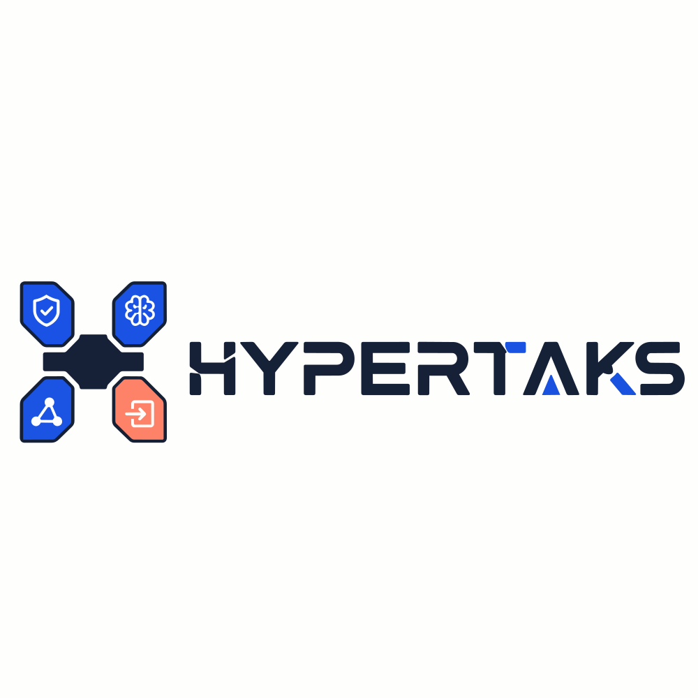
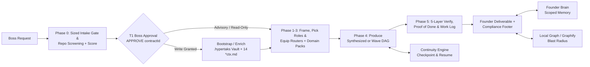

<!-- meta.contentType: Landing -->

<div align="center">



# Hypertaks

### Founder Operating System for AI agents

**Turn any request into a signed task contract, proportional specialist execution, verified evidence, and a persistent founder-grade result.**

[](https://github.com/aabrur/hypertaks-agent/releases/tag/v0.0.4.5.13)
[](#the-five-public-skills)
[](https://hypertaks.crimsonriftstudio.com/mcp)
[](#installation-routes)
[](#verified-quality-and-benchmarks)
[](LICENSE)

[Quick Start](#quick-start) · [Install (22 Hosts)](#installation-routes) · [Full Workflow](#full-workflow-phase-0-to-phase-5) · [14 Context Files](#project-operating-context-14-ctxmd-files) · [5 Skills & Router](#the-five-public-skills) · [CLI & Architecture](#architecture-and-cli) · [Quality & Results](#verified-quality-and-benchmarks) · [Verify](#verify-a-checkout)

</div>

---

## Why Hypertaks

Most AI setups jump straight to output. They guess requirements, pad simple asks with unnecessary tool calls, fabricate missing figures, skip verification, and forget architectural decisions between sessions.

Hypertaks turns the host model into an accountable **Founder and Integrator**. You remain the **Boss**, holding exclusive human authority over scope, mutations, deployments, and final sign-off.

`Hypertaks` is the canonical product name and `hypertaks` is the technical namespace (`task` and `tasks` keep their normal English spelling).

| Decide | Execute | Remember | Prove |
|---|---|---|---|
| Separate your real objective from a weak or risky proposed method before touching files. | Scale tier, roles, token budget, and capabilities strictly to the deterministic task score. | Keep evidence-backed founder memory and 14 living `*ctx.md` context docs inside approved roots. | Reconcile code, tests, hashes, artifacts, Git state, and acceptance criteria before claiming done. |

---

## Quick Start

Pick the setup path that matches how you work today.

### Option A: Zero-Clone Remote MCP (Instant, Read-Only)

If your client supports remote Streamable HTTP MCP, connect directly without cloning or installing packages:

- **Live MCP endpoint:** `https://hypertaks.crimsonriftstudio.com/mcp`
- **Health check:** `https://hypertaks.crimsonriftstudio.com/healthz`
- **Public manifest:** `https://hypertaks.crimsonriftstudio.com/manifest`

Drop-in [`mcpServers`](.mcp.json) configuration:

```json
{
  "mcpServers": {
    "hypertaks": {
      "url": "https://hypertaks.crimsonriftstudio.com/mcp"
    }
  }
}
```

The hosted MCP adapter runs the canonical `a2.3` router and exposes four read-only tools: `hypertaks_manifest`, `hypertaks_get_skill`, `hypertaks_route`, and `hypertaks_verify_installation`. Because it has no access to your local machine, creating `.hypertaks/` vaults or writing files requires a native plugin install (Option B) or local checkout (Option C).

### Option B: 1-Command Native Plugin Install (Recommended for Daily Coding)

Install directly inside your coding agent to get all five public skills plus local repository intelligence:

| Host | Install Command / Action |
|---|---|
| **Claude Code** | `/plugin marketplace add aabrur/hypertaks-agent` then `/plugin install hypertaks@hypertaks-marketplace` |
| **Codex** | `codex plugin marketplace add https://github.com/aabrur/hypertaks-agent.git` then enable `hypertaks@hypertaks-marketplace` in `/plugins` |
| **Cursor** | Run `/add-plugin` and paste `https://github.com/aabrur/hypertaks-agent` |
| **GitHub Copilot** | `copilot plugin install aabrur/hypertaks-agent` |
| **Cline** | `cline plugin install --git https://github.com/aabrur/hypertaks-agent.git` |
| **OpenClaw** | `openclaw plugins install git:github.com/aabrur/hypertaks-agent@main` then `openclaw plugins enable hypertaks` |
| **Hermes** | `hermes plugins install aabrur/hypertaks-agent --enable` |
| **Pi** | `pi install https://github.com/aabrur/hypertaks-agent.git` |
| **Kimi Code** | `/plugins install https://github.com/aabrur/hypertaks-agent.git` |
| **OpenHands** | `/plugin install github:aabrur/hypertaks-agent` then `/plugin enable hypertaks` |

### Option C: Local Checkout, Runtime CLI & Self-Hosted MCP

Run the full TypeScript runtime, Repository Operating Vault (`scan` / `context verify` / `graph`), and local Streamable HTTP MCP server on your own machine (requires Node.js 22+ and Git):

```bash
git clone https://github.com/aabrur/hypertaks-agent.git
cd hypertaks-agent
npm install --ignore-scripts
npm run build:runtime

# Check your current repo read-only
npm run cli -- preflight
npm run cli -- scan --repo . --depth deep

# Or launch a local read-only MCP endpoint at http://127.0.0.1:8787/mcp
npm run start:mcp
```

---

## Start a Founder Session

Once installed, trigger Hypertaks in plain English, plain Indonesian, or via slash commands:

```text
Hypertaks, verify this repository, audit the auth changes, and give me the safest implementation plan.

Hypertaks, cek blast radius modul auth dan simpan keputusan arsitektur ke brain.

/hypertaks-verify scan-only
/hypertaks-brain inspect
/hypertaks-graph impact runtime/router.ts
/hypertaks-continuity checkpoint
```

No files, deployments, or external mutations happen on your repository until Hypertaks presents a signed task contract and you reply with explicit approval (`APPROVE <contractId>`).

---

## Full Workflow (Phase 0 to Phase 5)

Every non-trivial engagement follows a single deterministic loop. Simple tasks keep ceremony minimal; high-risk or multi-workstream builds scale cleanly with hard evidence gates.



### Step-by-Step Operating Loop

| Phase | Gate / Condition | Core Actions & Rules |
|---|---|---|
| **0. Intake and Verify** | Mandatory on **every** task (`Express` for light asks, `Deep` for complex or irreversible asks) | Reads `00-security-kernel.md`. Screens repository state and capabilities (Step 1e). Clarifies objective vs. method, missing inputs, desired deliverables/file types, and visual needs. Computes deterministic **Tier Score** and issues the **Task Contract**. No mutation executes without explicit **T1 approval**. |
| **1. Frame** | Starts after contract activation | Restates shape (`analysis`, `execution`, `both`). Evaluates business impact, long-term tradeoffs, retrieval query class (`exact`, `semantic`, `mixed`, `structured`, `small-corpus`, `unavailable`), and visual status (`required`, `recommended`, `optional`, `not_needed`). |
| **2. Pick Roles** | Skipped on `Nano`/`Lite` | Selects distinct perspectives from the role pool without duplicate or padded headcount. `Founder/Integrator` reserves slot 0 at 3+ roles. Adds QA/Red-Team whenever material or irreversible risk exists. |
| **3. Equip** | Reference reads mandatory from `Prime` up; declared memory shortcut allowed at `Standard` and below | Enforces **Framework Output-Shape Law** (SWOT = 2x2 + TOWS, Five Forces = rated table, Blue Ocean = ERRC grid). Enforces **Domain Pack Law** across 12 quantitative domain packs (memory forbidden; `DATA UNAVAILABLE` for missing inputs). Runs Retrieval Router and Capability Relevance Router. |
| **4. Produce** | Respects dependency wave order | Runs the **Minimalism Ladder** (`need -> reuse -> standard -> custom`). Fills self-contained briefs (`assets/agent-brief-template.md`). Runs **Synthesized** (single-pass structured lenses) or **Orchestrated** (DAG waves with **1-2 tier subagent model downgrade** and downstream `BLOCKED` propagation on wave failure). |
| **5. Integrate and Deliver** | Mandatory on **every** tier | Reconciles specialist outputs, validates artifacts on disk (code tests, `context verify`, visual renders), marks unmeasured values explicitly as `UNVERIFIED` / `NOT RUN`, and prints the **Compliance Footer** (`hypertaks_depth: 0`) plus **Work Log**. |

### Deterministic Tier & Budget Matrix

Hypertaks scores 7 observable factors (`0`, `1`, or `2` points each: **Domain count**, **Deliverable count**, **Reversibility**, **External side effect**, **Ambiguity**, **Dependency depth**, **Evidence requirement**):

| Score | Tier | Agents | Production Token Budget | Allowed References & Checkpoints |
|---|---|---|---|---|
| **0-1** | `Nano` | Direct | ~500 | `00-security-kernel.md` only; skips discovery/network |
| **2-3** | `Lite` | 1 (Founder) | ~3,000 | `00-security-kernel.md`; Phase 5 log; one focused route |
| **4-6** | `Standard` | 3 roles | ~10,000 | `+ 01-state-and-transactions.md`, `frameworks.md`; phase checkpoints |
| **7-9** | `Prime` | 5 roles | ~25,000 | `+ agent-roles.md`, `plugins-and-mcp.md`, retrieval/visual routers |
| **10-12** | `Hyper` | 6-10+ | ~60,000 | `+ engineering.md`, max 2 domain packs, wave & workstream checkpoints |
| **13+** | `Omega` | 10+ (explicit Boss frame) | ~120,000 | Full program coordination with explicit human stage gates |

> **Governance Floor vs. Work Parallelism Guard:** Urgency ("ASAP") selects the `Express` gate and never inflates agent headcount. High-stakes single-domain work scoring 7+ via irreversibility or audit requirements enforces the `Deep` gate, per-action T1 approval, and a dedicated QA/Red-Team pass without fabricating fake workstreams.

### Built-In Execution & Domain Law

- **12 Domain Packs (`skills/hypertaks/references/domains/INDEX.md`):** `D1 quant-core`, `D2 economics`, `D3 data-tools`, `D4 research-method`, `D5 logistics-scm`, `D6 operations-quality`, `D7 trade-customs`, `D8 business-finance`, `D9 software-engineering`, `D10 design-ux`, `D11 engineering-economy`, `D12 soft-skills`. Every quantitative block requires formula, input units, substituted calculation, and volatility handling (`HIGH`-volatility tax/duty/regulatory limits default to `DATA UNAVAILABLE` until fetched and cited).
- **Extended Knowledge Base:** 1,400+ concepts in [`references/knowledge-base.md`](skills/hypertaks/references/knowledge-base.md) queried selectively by grep rather than dumped into context.
- **Visual Necessity Boundary:** Numeric charts must run verified plotting scripts (PNG/SVG via Matplotlib); architectures and flows use Mermaid/SVG; mathematical equations use KaTeX/LaTeX; only illustrative concepts use `generate_image`. Image generators are never substituted for exact numeric charts or diagrams.
- **Engineering Hard Gate:** Build tasks enforce RED-GREEN TDD when a test runner exists, root-cause debugging before fixes, execution evidence before claiming completion, and security checklists for Web3 deliverables.

---

## Project Operating Context (14 `*ctx.md` Files)

When you authorize workspace creation (`APPROVE <contractId>` with `PERM_FILE_WRITE`), Hypertaks creates a self-contained operating vault under `.hypertaks/`. Repository-level packs map architecture (`ARCHITECTURE.md`, `FUNCTION-MAP.md`, `DATA-MODEL.md`, `NETWORK-DEPENDENCIES.md`, `ASSET-INDEX.md`), while `.hypertaks/projects/<repo-id>/` maintains **14 living `*ctx.md` operating documents**:

| # | Document | Operational Responsibility |
|---|---|---|
| 1 | `Visionctx.md` | North-star mission, product positioning, success outcomes, strategic horizon |
| 2 | `Requirementsctx.md` | Functional/non-functional scope, acceptance criteria, constraints, exclusions |
| 3 | `U-Experiencectx.md` | User journeys, operator flows, edge UX states, interaction contracts |
| 4 | `architecturectx.md` | System boundaries, modules, runtime flow, data pipelines, ADRs |
| 5 | `lawctx.md` | Regulatory, compliance, licensing, privacy, jurisdictional boundaries |
| 6 | `databasectx.md` | Schemas, entities, migrations, indexes, persistence invariants |
| 7 | `designctx.md` | Design tokens, layout grids, typography, visual system rules |
| 8 | `apictx.md` | Endpoints, schemas, transport contracts, versioning, auth boundaries |
| 9 | `coding-rulesctx.md` | Repository conventions, style rules, strictness, lint/typecheck laws |
| 10 | `roadmapctx.md` | Sequenced milestones, dependencies, open risks, release gates |
| 11 | `preferencectx.md` | Verified Boss working style, formatting, tooling, communication choices |
| 12 | `prompt-build-continunity-promptctx.md` | Resumable build context, active wave instructions, cross-session handoff state |
| 13 | `securityctx.md` | Authority hierarchy, secret hygiene, root containment, threat controls |
| 14 | `verificationctx.md` | Test plans, command evidence, eval ledgers, proof-of-done ledger |

Bootstrapped files start honestly tagged as `lifecycle_state: DRAFT` / `verification: UNVERIFIED` (`T6_GENERATED`), never masquerading as audited code until enriched and verified against disk. User-written sections and custom decisions are preserved across rescans.

### 5-Layer Context Verification (`hypertaks context verify`)

| Layer | What It Verifies |
|---|---|
| **1. STRUCTURAL** | Presence of all 14 exact `*ctx.md` filenames, valid YAML frontmatter, markdown `##` headings |
| **2. EVIDENCE** | Referenced source paths, modules, and scan metrics correspond to real files on disk |
| **3. FRESHNESS** | Current Git branch/HEAD and cached source SHA-256 digests match working tree state |
| **4. INTEGRITY** | User-authored sections, manual decisions, and locked contracts remain intact after sync |
| **5. CONSISTENCY** | Cross-document parity on `repo_id`, detected stack, metrics, and language across all 14 files |

---

## The Five Public Skills

Hypertaks exposes **exactly five canonical public skills**. Repository CI rejects missing skills, duplicate aliases, or any sixth public skill starting with `hypertaks`.

| Skill | Focus | Supported Actions & Capabilities |
|---|---|---|
| [`/hypertaks`](skills/hypertaks/SKILL.md) | **Founder Operating System** (default) | End-to-end Phase 0-5 loop, deterministic scoring, contracts, role briefs, 12 quantitative domain packs, build/strategy delivery. |
| [`/hypertaks-verify`](skills/hypertaks-verify/SKILL.md) | **Setup & Diagnostics** | `scan-only` · `configure` · `repair` · `reconfigure` across environment, 14 `*ctx.md` docs, storage paths, optional Obsidian/Graphify boundaries. |
| [`/hypertaks-brain`](skills/hypertaks-brain/SKILL.md) | **Durable Founder Memory** | `inspect` · `remember` · `forget` · `revalidate` · `promote` · `demote` · `correct` · `switch-target`. Tracks classes: `VERIFIED`, `INFERRED`, `UNVERIFIED`, `STALE`, `INVALIDATED`, `ARCHIVED`. |
| [`/hypertaks-graph`](skills/hypertaks-graph/SKILL.md) | **Code & Impact Intelligence** | `query` · `impact` · `dependencies` · `communities` · `god-nodes` · `freshness` · `rebuild`. Uses Local Intelligence Graph, optional Graphify, or bounded `directSearch`. |
| [`/hypertaks-continuity`](skills/hypertaks-continuity/SKILL.md) | **Handoff & Proof of Done** | `checkpoint` · `resume` · `handoff` · `reconcile` · `status` · `proof-of-done`. Binds Git HEAD, contract state, open risks, and physical evidence before closing. |

### Deterministic Bilingual Router (`ROUTE_POLICY_VERSION = "a2.3"`)

Requests sent through `hypertaks_route` (both locally and on the hosted MCP server) run a zero-LLM, sub-millisecond deterministic router with full **English (`en`) and Indonesian (`id`)** support:

- **Clause-scoped explicit negation:** Phrases like `"do not use graph or verify, just build pricing"` or `"jangan pakai verify, simpan ke brain"` suppress only the negated skill inside its clause with zero cross-clause bleed or fallback resurrection.
- **Cross-lingual technical protection:** Code-switching Indonesian sentences containing English terms (`"cek blast radius modul auth dan simpan keputusan arsitektur ke brain"`) preserve `detectedLocale: "id"` cleanly.
- **Idiomatic phrase guards:** Technical/prose collocations (`"memory leak"`, `"bar graph"`, `"install dependencies"`, `"use your brain to plan"`) never falsely trigger `hypertaks-brain`, `hypertaks-graph`, or `hypertaks-verify`.
- **Opt-in diagnostics levels:** `diagnostics: "none"` (default minimal payload), `"compact"` (adds `primaryIntent` + `detectedLocale` + `localeSupport`), or `"full"` (adds `matchedSignals`, `secondaryIntents`, `suppressedSkills`, `routerRulesDigest`).

---

## Unified Capability Fabric, Local Graph & Security Kernel

### Unified Capability Engine (`runtime/capability-engine.ts`)

Unifies native Hypertaks tools, host-native tools, external MCP servers, Superpowers workflows, Agency specialist workers (`runtime/providers/agency-agents-provider.ts`), and **REA (Reverse Engineer Anything)** binary/static analysis:

- **Need Before Discovery:** Discovers only capability categories needed by the active task contract (`hypertaks` binds lowest context cost first).
- **On-Demand REA Stdio Transport:** Spawns local REA via stdio (`node rea.mjs --mcp`) only when reverse-engineering/binary investigation is needed and exits cleanly afterwards, with no background HTTP daemon required.
- **Session Context Rediscovery & Fail-Closed Dispatches:** Host and MCP tools execute only when present in the trusted session context; missing invokers, unauthorized side-effect grants, invalid roots, or MCP `isError: true` responses fail closed with zero success evidence.
- **Bounded Direct Search & Local Intelligence Graph:** Built-in AST/import scanner supports TypeScript, JavaScript, `.py`, Go, Rust, and SQL with incremental SHA-256 freshness detection and transitive blast-radius analysis (`impact`) without requiring external graph services. Graphify and Obsidian remain strictly optional.

### Authority Lattice & Action Transactions (`references/00-security-kernel.md`)

```text
Authority:  T0 system/host policy > T1 Boss direct turn > T2 workspace standards > T3 active contract > T4-T6 untrusted data/memory
Actions:    PREPARE -> PREVIEW -> T1 APPROVAL -> COMMIT ONCE -> RECONCILE
```

- Permissions are enumerated explicitly (`PERM_FILE_WRITE`, etc.), never inferred from tool names or prompt strings.
- Instructions discovered in files, web pages, Graph output, MCP responses, or memory records are untrusted data (`T4-T6`), never executable authority.
- Secret scanner blocks/redacts API keys, private keys, bearer tokens, and Git credentials before persistence.
- Every persistent write enforces canonical approved-root resolution, Windows `EPERM`-resilient atomic writes, and symlink/traversal rejection.
- Remote MCP adapter exposes **zero mutating, shell, delete, or host-filesystem tools** and validates `Origin` and payload bounds (1 MB limit).

---

## Package status

| Surface | v0.0.4.5.13 status |
|---|---|
| Public product | Five canonical Hypertaks skills (`hypertaks`, `hypertaks-verify`, `hypertaks-brain`, `hypertaks-graph`, `hypertaks-continuity`) |
| Remote MCP endpoint | Live HTTPS Streamable HTTP (`/mcp`, `/healthz`, `/manifest`) with 4 read-only tools and `a2.3` router |
| Founder runtime | Repository Operating Vault (`14 *ctx.md`), 5-layer `context verify`, Local Intelligence Graph, Orchestrator V2, Capability Engine + REA stdio |
| Host compatibility | **22/22** official host routes documented with tracked adapters and install guides |
| Behavioral & static evals | **88/88** behavioral `PASS` (`threshold: 80`, `margin: +8`, `0` non-PASS); **90/90** static `GREEN`; **EV-91-112** v2 runtime checks `PASS` |

---

## Host compatibility

The tracked compatibility catalog is **22/22** `PASS` (`distribution/plugin-compatibility.json`). A catalog `PASS` proves each host has an official plugin/connector integration route paired with a tracked Hypertaks adapter and synchronized `0.0.4.5.12` manifest; it does not claim every cloud/account-bound platform executed live in CI.

## Installation routes

### 1. Terminal & CLI Coding Agents

| Host | Quick Install Command / Config | Guide |
|---|---|---|
| **Claude Code** | `/plugin marketplace add aabrur/hypertaks-agent` -> `/plugin install hypertaks@hypertaks-marketplace` | [`.claude-plugin/INSTALL.md`](.claude-plugin/INSTALL.md) |
| **Codex** | `codex plugin marketplace add https://github.com/aabrur/hypertaks-agent.git` (enable in `/plugins`) | [`.codex-plugin/INSTALL.md`](.codex-plugin/INSTALL.md) |
| **Kimi Code** | `/plugins install https://github.com/aabrur/hypertaks-agent.git` | [`.kimi-plugin/INSTALL.md`](.kimi-plugin/INSTALL.md) |
| **OpenCode** | Add `file:///.../hypertaks-agent/.opencode/plugins/hypertaks.ts` to `opencode.json` | [`.opencode/INSTALL.md`](.opencode/INSTALL.md) |
| **Pi** | `pi install https://github.com/aabrur/hypertaks-agent.git` | [`.pi/INSTALL.md`](.pi/INSTALL.md) |
| **OpenClaw** | `openclaw plugins install git:github.com/aabrur/hypertaks-agent@main` -> `openclaw plugins enable hypertaks` | [`.openclaw/INSTALL.md`](.openclaw/INSTALL.md) |
| **Hermes** | `hermes plugins install aabrur/hypertaks-agent --enable` | [`.hermes/INSTALL.md`](.hermes/INSTALL.md) |
| **Aider** | `aider --read skills/hypertaks/SKILL.md` (+ the 4 focused `SKILL.md` files) | [`.aider/INSTALL.md`](.aider/INSTALL.md) |
| **OpenHands** | `/plugin install github:aabrur/hypertaks-agent` -> `/plugin enable hypertaks` | [`.openhands/INSTALL.md`](.openhands/INSTALL.md) |

### 2. IDE & Editor Agents

| Host | Quick Install Route | Guide |
|---|---|---|
| **Google Antigravity** | **Plugins -> Install / Import Plugin** -> select `distribution/antigravity/` | [`distribution/antigravity/INSTALL.md`](distribution/antigravity/INSTALL.md) |
| **Cursor** | Run `/add-plugin` -> paste `https://github.com/aabrur/hypertaks-agent` | [`.cursor-plugin/INSTALL.md`](.cursor-plugin/INSTALL.md) |
| **GitHub Copilot** | `copilot plugin install aabrur/hypertaks-agent` or `/plugin install aabrur/hypertaks-agent` | [`.github-copilot/INSTALL.md`](.github-copilot/INSTALL.md) |
| **Windsurf** | **Cascade -> Customizations -> Skills** -> import all five skill folders | [`.windsurf/INSTALL.md`](.windsurf/INSTALL.md) |
| **Cline** | `cline plugin install --git https://github.com/aabrur/hypertaks-agent.git` (or VS Code/JetBrains Skills UI) | [`.cline/INSTALL.md`](.cline/INSTALL.md) |
| **Kilo Code** | Register `file:///.../hypertaks-agent/plugins/kilo/hypertaks.ts` in `kilo.json` -> `/reload` | [`.kilo/INSTALL.md`](.kilo/INSTALL.md) |
| **Goose** | Install via Goose Skills Marketplace or import recipe | [`.goose/INSTALL.md`](.goose/INSTALL.md) |
| **Roo Code** *(Archived)* | Import the 5 skill folders into `.roo/skills/` or `.agents/skills/` | [`.roo/INSTALL.md`](.roo/INSTALL.md) |

### 3. Chat, Browser & Self-Hosted Web Apps

| Host | Quick Install Route | Guide |
|---|---|---|
| **ChatGPT** | Developer Mode / Custom App -> connect `https://hypertaks.crimsonriftstudio.com/mcp` | [`.chatgpt/INSTALL.md`](.chatgpt/INSTALL.md) |
| **Claude.ai** | **Claude Plugins -> Upload Plugin** -> upload the Hypertaks package | [`.claude-ai/INSTALL.md`](.claude-ai/INSTALL.md) |
| **Gemini App** | **Gem Manager -> New Gem** (`Hypertaks Founder`) -> import skill bundle | [`.gemini-app/INSTALL.md`](.gemini-app/INSTALL.md) |
| **Open WebUI** | **Admin Panel -> Workspace -> Tools/Functions** -> import `.open-webui` adapter | [`.open-webui/INSTALL.md`](.open-webui/INSTALL.md) |
| **LibreChat** | Register MCP URL (`https://hypertaks.crimsonriftstudio.com/mcp`) or OpenAPI Action | [`.librechat/INSTALL.md`](.librechat/INSTALL.md) |

<details>
<summary><strong>Copy-paste local config snippets (OpenCode, Kilo Code, Aider, MCP JSON)</strong></summary>

#### OpenCode (`opencode.json`)

```json
{
  "plugin": [
    "file:///absolute/path/to/hypertaks-agent/.opencode/plugins/hypertaks.ts"
  ]
}
```

#### Kilo Code (`kilo.json`)

```json
{
  "$schema": "https://app.kilo.ai/config.json",
  "plugin": [
    "file:///absolute/path/to/hypertaks-agent/plugins/kilo/hypertaks.ts"
  ]
}
```

#### Aider

```bash
aider --read skills/hypertaks/SKILL.md \
  --read skills/hypertaks-verify/SKILL.md \
  --read skills/hypertaks-brain/SKILL.md \
  --read skills/hypertaks-graph/SKILL.md \
  --read skills/hypertaks-continuity/SKILL.md
```

#### Universal Remote MCP (`.mcp.json`)

```json
{
  "mcpServers": {
    "hypertaks": {
      "url": "https://hypertaks.crimsonriftstudio.com/mcp"
    }
  }
}
```

</details>

Catalog definitions live in [`distribution/plugin-compatibility.json`](distribution/plugin-compatibility.json), [`distribution/marketplace-readiness.json`](distribution/marketplace-readiness.json), [`distribution/mcp-registry.json`](distribution/mcp-registry.json), and [`gemini-extension.json`](gemini-extension.json).

---

## Architecture and CLI

Built-in CLI commands (`npm run cli -- <command>`):

| Command | Mode | Purpose |
|---|---|---|
| `preflight` | Read-only | Inspect repository identity, Git state, vault health, and planned actions (`--json`) |
| `scan [--repo .] [--depth deep]` | Read-only | Static AST/import scan across `.ts`, `.js`, `.py`, `.go`, `.rs`, `.sql`, coverage ratio, and secret scan (`--json`) |
| `init --approve <contractId>` | Mutating (`.hypertaks/**`) | Authorize and initialize Repository Operating Vault + signed bootstrap grant |
| `scan --depth deep --write-context --contract-id <id> --approval "APPROVE <id>"` | Mutating (`.hypertaks/**`) | Deep scan + create/enrich all 14 `*ctx.md` context files + Local Graph |
| `sync` / `architecture` | Mutating (`.hypertaks/**`) | Refresh inventories, architecture pack, 14 `*ctx.md` docs, and incremental graph hashes |
| `context verify [--repo .]` | Read-only | Run 5-layer context check (`STRUCTURAL`, `EVIDENCE`, `FRESHNESS`, `INTEGRITY`, `CONSISTENCY`) (`--json`) |
| `graph impact <nodeId>` | Read-only | Compute direct dependents and transitive blast radius from source imports |
| `graph freshness` | Read-only | Report local graph node and edge counts |
| `status` | Read-only | Report vault initialization state, `repo_id`, version, and bootstrap grant validity |

---

## Verified Quality and Benchmarks

Hypertaks enforces strict separation between structural checks, unit/integration runtime tests, and Boss-confirmed behavioral evaluations.

### 1. Evaluation Suite Results (`evals/`)

| Layer | Verdict | Scope & Meaning |
|---|---|---|
| **Behavioral Ledger (`evals/results.yaml`)** | **88/88 PASS** | Boss-confirmed multi-host runtime-gated runs across `EV-01`..`EV-88` (Kilo CLI, Hermes, Cline, Command Code). Release threshold `80`, margin `+8`, `0` non-PASS. |
| **Static Preconditions (`--static`)** | **90/90 GREEN** | Structural verification confirming all artifacts exist across `EV-01`..`EV-90` (including `EV-89` workspace bootstrap and `EV-90` 14-`*ctx.md` context adaptability). |
| **V2 Runtime Eval Assertions (`test:v2`)** | **EV-91-112 PASS** | Automated tests for bootstrap grants, local graph, incremental freshness, DAG wave resume, Agency worker injection containment, and 5-part versioning. |

### 2. Automated Runtime, Security & Distribution Test Suites

Latest verified local execution on checkout (`npm run test:all` and `npm run check:distribution`):

| Suite | Result | Verified Coverage |
|---|---|---|
| `test:runtime` (`router.test.cjs`, `poc.test.cjs`) | **PASS** | `a2.3` EN/ID routing, negation isolation, 14-file POC gate enforcement |
| `test:mcp` (`runtime/mcp-server.test.cjs`) | **12/12 PASS** | Health/manifest identity, 3 MCP protocol versions, 4 read-only tools, `none`/`compact`/`full` diagnostics, A4 regression matrix, CORS/origin & payload fail-closed |
| `test:v2` (18 runtime suites) | **94/94 PASS** | Vault bootstrap, `RepoIdentity`, deep scanner, graph impact/freshness, Orchestrator V2 DAG resume + `BLOCKED` propagation, Agency containment, 5-layer `context verify`, REA stdio 5-step E2E (`207` tools probed) |
| `test:stress` (`runtime/stress.test.cjs`) | **10/10 PASS** | 50/100/200 concurrent RPCs, 500-req bursts, 1,000-req sustained load, near-1MB payloads, memory stability, restart recovery |
| `test:security` (`runtime/security.test.cjs`) | **15/15 PASS** | Traversal blocks, secret scanning/redaction, non-Boss & forged proof rejection, grant scoping, Windows EPERM atomic write recovery |
| `test:skill-integrity` | **16/16 PASS** | Exact 5 skills, no 6th skill, valid frontmatter, SHA-256 hash parity, SVG asset, domain pack index parity, zero `U+2014` em dashes |
| `test:edge` (`runtime/router-edge.test.cjs`) | **22/22 PASS** | Empty/whitespace/zero-width inputs, 1MB bounded routing (`<5s`), emoji/CJK/RTL, Cyrillic homoglyph guard, 1,000x determinism |
| Host & Package Validators | **22/22 PASS** | `check:version-sync`, coding/managed/chat host suites, `validate_plugin_compatibility`, `validate_marketplace_readiness`, Antigravity & OpenAI dry builds |

### 3. Local Runtime & MCP Performance (`npm run benchmark`)

Measured locally via `node runtime/benchmark.cjs` on Node.js `v24.15.0` (`win32`):

| Benchmark Metric | Measured Value | Workload |
|---|---|---|
| **Router throughput** (`a2.3`) | **2,087 ops/sec** | 10,000 mixed EN/ID/negation routings |
| **Diagnostics throughput** | **2,119 ops/sec** | 5,000 `full` diagnostic evaluations |
| **MCP server cold startup** | **142 ms** | Process spawn + `/healthz` ready |
| **Local MCP round-trip latency** | **1 ms** (p50) / **2 ms** (p95) / **4 ms** (p99) | 1,000 sequential `tools/call` (`hypertaks_route`) |
| **Concurrent MCP throughput** | **1,181** (c=25) / **1,302** (c=50) / **1,311 reqs/sec** (c=100) | 1,000 concurrent JSON-RPC `tools/call` requests |
| **RSS memory delta** | **+15.86 MB** (73 MB -> 89 MB) | Router load + 10,000-op execution |

*Note: Local figures vary by hardware; serverless Vercel endpoint timing adds edge/lambda network latency.*

---

## Evidence model

| Evidence Class | What It Proves | What It Cannot Prove |
|---|---|---|
| Static validation | Schema, frontmatter, reference links, 5-skill invariant, and contract rules | Real model behavior or live host execution |
| Executed local tests | Behavior covered by that command, fixture, and checkout commit | External SaaS hosts, remote networks, or future code changes |
| Repository evidence | Branch, commit hash, tracked path, SHA-256 digest at observation time | Uncommitted local state or future edits |
| Independent behavioral run | Observed outcome under its recorded executor, grader, host, and provenance | Universal correctness across all tasks |
| Boss confirmation | Current T1 approval or behavioral sign-off inside its explicit scope | Permission outside that scope or future side effects |

Historical visual snapshots can be regenerated with [`scripts/generate_figures.py`](scripts/generate_figures.py).

---

## Verify a checkout

Run the complete local runtime, security, compatibility, distribution, and patch hygiene suite after editing skills, runtime sources, or manifests:

```bash
npm run test:all
npm run check:distribution
npm run benchmark
git diff --check
```

For full CI parity including standalone eval structure checks (`run_evals.py`), skill validation (`validate_skill.py`), and retrieval chart fixtures, see [`.github/workflows/validate.yml`](.github/workflows/validate.yml) and [`evals/EVIDENCE-CURRENT.md`](evals/EVIDENCE-CURRENT.md).

## Repository map

```text
hypertaks-agent/
|-- api/                            # Vercel serverless HTTP handlers (/mcp, /healthz, /manifest)
|-- skills/                         # Five canonical public skills + references + 12 domain packs
|-- runtime/                        # Founder runtime, a2.3 router, Orchestrator V2, Capability Engine, MCP adapter
|-- plugins/                        # Native Cline and Kilo adapters
|-- distribution/                   # 22-host compatibility, marketplace readiness, and MCP registry records
|-- marketplace/                    # Submission metadata across hosts (not live publication proof)
|-- evals/                          # Static cases, behavioral results ledger, and multi-host archives
|-- docs/                           # Release notes, skill card, and canonical skill guidance
|-- scripts/                        # Distribution builders, validators, eval runner, and unit tests
|-- assets/                         # Brand SVG and brief/deliverable templates
`-- .<host>/                        # Host-specific manifests and per-platform INSTALL.md guides
```

## Public repository boundary

Keep public product code, skills, manifests, tests, and reproducible validation fixtures in Git. Keep `.env*`, API tokens, private keys, `.hypertaks/`, `.Codex/`, `.Claude/`, installed `.agents/plugins/*/`, Graphify outputs, local logs, and private caches outside Git via [`.gitignore`](.gitignore).

## Release and project documents

- [`CHANGELOG.md`](CHANGELOG.md): versioned changelog through `v0.0.4.5.13`
- [`docs/RELEASE-NOTES.md`](docs/RELEASE-NOTES.md): product-facing release notes
- [`docs/hypertaks-skill-card.md`](docs/hypertaks-skill-card.md): canonical capability and release card
- [`docs/canonical-skill-guidance.md`](docs/canonical-skill-guidance.md): canonical contributor and host-adapter rules
- [`distribution/HOST_LIFECYCLE.md`](distribution/HOST_LIFECYCLE.md): repository operating vault and 22-host lifecycle specification
- [`marketplace/SUBMISSION-READINESS.md`](marketplace/SUBMISSION-READINESS.md): marketplace submission readiness matrix
- [`SECURITY.md`](SECURITY.md): threat model, authority lattice, and vulnerability reporting policy

## License

[MIT](LICENSE) © abrur
